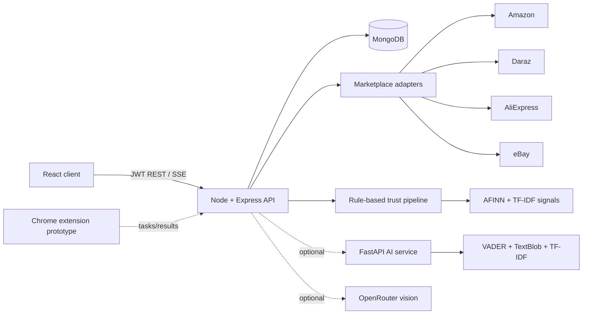

<p align="center"></p>

<h1 align="center">ShopO-AI</h1>
<p align="center"><strong>AI-Powered Price Intelligence &amp; Product Authenticity Engine</strong></p>
<p align="center">Compare marketplace listings, inspect review signals, and receive an explainable buying recommendation from one workspace.</p>

<p align="center">
  
  
  
  
  <a href="../../actions/workflows/ci.yml"></a>
</p>

<p align="center"><a href="#overview">Overview</a> · <a href="#capabilities">Capabilities</a> · <a href="#how-it-works">Architecture</a> · <a href="#run-locally">Setup</a> · <a href="#testing">Testing</a> · <a href="docs/ARCHITECTURE.md">Technical docs</a></p>

## Overview

Online shoppers often compare prices and trust signals across several marketplaces by hand. ShopO-AI brings those steps together: authenticated users search supported marketplaces, compare normalized listings, and run a transparent risk analysis using price position, seller rating, review volume, sentiment, and duplicate-review signals.

> **Scope:** the displayed “authenticity score” is an explainable risk heuristic. It is not a validated counterfeit classifier and should support, rather than replace, the buyer’s judgment.

## Capabilities

- **Multi-market search:** concurrent acquisition adapters for Amazon, Daraz, AliExpress, and eBay, with incremental Server-Sent Events updates and one-hour MongoDB caching.
- **Price comparison:** normalized price cards, sorting, platform filters, and average-price context.
- **Explainable trust analysis:** four 25-point factors—price, seller rating, review volume, and review sentiment—produce a Buy, Risky, or Avoid recommendation.
- **Review intelligence:** local AFINN analysis in Node plus an optional Python ensemble using VADER and TextBlob; TF-IDF cosine similarity identifies near-duplicate or irrelevant reviews.
- **History and authentication:** JWT-protected registration, login, saved analyses, and analysis detail views.
- **Image workflow:** authenticated upload and URL routes call an optional OpenRouter vision model when configured. A separate perceptual-hash logo prototype and an ONNX artifact are included but are not connected to the active API.
- **Browser extension prototype:** an unpacked Chrome extension can receive acquisition tasks from the API and return page results.

## Application preview

<p align="center"></p>

| Search and price comparison | Explainable analysis |
|---|---|
|  |  |

See [Screenshot status](docs/SCREENSHOT_STATUS.md) for the source and limitations of every demonstration asset.

## How it works



1. The user signs in and sends a search query with selected marketplaces.
2. The API checks the per-user cache, then streams each marketplace result as its adapter completes.
3. Selecting a listing runs the local scoring pipeline; when enabled, the Python service adds ensemble sentiment, fake-review, and trustworthiness evidence.
4. MongoDB stores the analysis, and the client renders the factor breakdown, sentiment distribution, and recommendation.

Read [Architecture](docs/ARCHITECTURE.md) and [AI methodology](docs/AI_METHODOLOGY.md) for boundaries, formulas, and data flow.

## Technology stack

| Layer | Technology |
|---|---|
| Web | React 18, React Router, Recharts, React Toastify |
| API | Node.js, Express, Mongoose, JWT, express-validator |
| Acquisition | Puppeteer, Cheerio, Axios, optional Chrome extension |
| Analysis | `sentiment`/AFINN, Natural TF-IDF, FastAPI, VADER, TextBlob, scikit-learn |
| Data | MongoDB |
| Delivery | Render configuration, Vercel client configuration, GitHub Actions |

## Run locally

### Prerequisites

- Node.js 20 or newer and npm
- Python 3.10 or newer
- MongoDB 7/8 available on `localhost:27017`
- Chrome or Chromium for live marketplace acquisition

```bash
git clone https://github.com/mujtabashah1/ShopO-AI.git
cd ShopO-AI
npm run install-all
python -m venv python-ai/.venv
# Windows: python-ai\.venv\Scripts\activate
# macOS/Linux: source python-ai/.venv/bin/activate
pip install -r python-ai/requirements.txt
cp .env.example .env
npm run dev-all
```

Open `http://localhost:3000`. On Windows, `powershell -ExecutionPolicy Bypass -File .\start-local.ps1` starts the checked local services after dependencies are installed.

### Environment

| Variable | Required | Purpose |
|---|---:|---|
| `MONGO_URI` | Yes | MongoDB connection URI |
| `JWT_SECRET` | Yes | Long random token-signing secret |
| `PORT` | No | Express port; defaults to 5000 |
| `PYTHON_AI_URL` | No | FastAPI URL; defaults to `http://localhost:8000` |
| `PYTHON_AI_ENABLED` | No | Enables enhanced Python analysis |
| `OPENROUTER_API_KEY` | Image only | Enables image identification and vision verification |
| `OPENROUTER_MODEL` | No | OpenRouter vision model identifier |
| `CLIENT_URL` | No | Allowed client origin(s) |

Never commit `.env`; the tracked [.env.example](.env.example) contains placeholders only. See [Development](docs/DEVELOPMENT.md) for database access and service-by-service commands.

## API at a glance

All product, analysis, and extension routes require `Authorization: Bearer <token>`.

| Method | Route | Purpose |
|---|---|---|
| POST | `/api/auth/register`, `/api/auth/login` | Create a user or obtain a JWT |
| GET | `/api/auth/me` | Return the authenticated user |
| GET | `/api/products/search` | Search selected marketplaces |
| GET | `/api/products/search/stream` | Stream incremental marketplace results |
| POST | `/api/analysis/analyze` | Calculate and persist a product analysis |
| GET | `/api/analysis/history`, `/api/analysis/:id` | Read saved analyses |
| POST | `/api/analysis/verify-image`, `/verify-url` | Optional vision-provider verification |

The complete request contracts are in [API reference](docs/API_REFERENCE.md).

## AI/ML methodology

The active recommendation pipeline is combined and explainable:

- **Rules:** four weighted factors create a 0–100 risk score; thresholds are Buy ≥75, Risky 45–74, Avoid <45.
- **Lexicon analysis:** Node uses AFINN; the optional Python service averages VADER and TextBlob polarity.
- **Classical text features:** TF-IDF and cosine similarity flag highly similar review pairs and weak product relevance. Python adds linguistic indicators.
- **Vision:** image routes depend on a third-party multimodal model. The included ONNX file is not loaded by the running application and has not been independently evaluated.

No labelled counterfeit evaluation set or defensible accuracy measurement is present. Results therefore describe risk signals, not proof of authenticity. See [AI methodology](docs/AI_METHODOLOGY.md).

## Testing

```bash
npm test
cd client && npm test -- --watchAll=false --runInBand
npm run build
```

The suite covers the Node scoring contract, sentiment, duplicate review signals, Python service contracts, and client utilities. Live scraper checks are manual integration tests because marketplace markup, bot controls, geography, and network conditions change. The latest audit is recorded in [Testing](docs/TESTING.md).

## Status and limitations

- Amazon, Daraz, and AliExpress returned live results during the documented local audit; eBay did not match its current page structure.
- Marketplace adapters scrape public pages and can break when markup or access controls change.
- Cross-market currency normalization depends on adapter logic and is not a live foreign-exchange feed.
- Image verification needs a user-supplied OpenRouter key and was blocked in the local audit.
- Logo datasets have no documented provenance or redistribution licence; use them for research review only.
- There is no project-level licence file, so reuse rights are not granted by this repository.

See [Features](docs/FEATURES.md), [Known limitations](docs/KNOWN_LIMITATIONS.md), and the [roadmap](docs/KNOWN_LIMITATIONS.md#roadmap).

## Project structure

```text
client/             React application
server/             Express API, models, acquisition adapters, scoring
python-ai/          Optional FastAPI analysis service
extension/          Chrome extension acquisition prototype
logo-detection/     Research notebook and reference images
docs/               Architecture, API, QA, screenshots, portfolio assets
start-local.ps1     Windows local-service launcher
```

## Academic context and team

ShopO-AI is a Final Year Project at **FAST-NUCES Peshawar**, developed by **Syed Ahmad Mujtaba Shah** and **Muhammad Waseel**, under the supervision of **Dr. Usman Wajid**.

Repository: [github.com/mujtabashah1/ShopO-AI](https://github.com/mujtabashah1/ShopO-AI)

Security guidance, privacy boundaries, and responsible disclosure notes are documented in [Development](docs/DEVELOPMENT.md#security-and-privacy).
