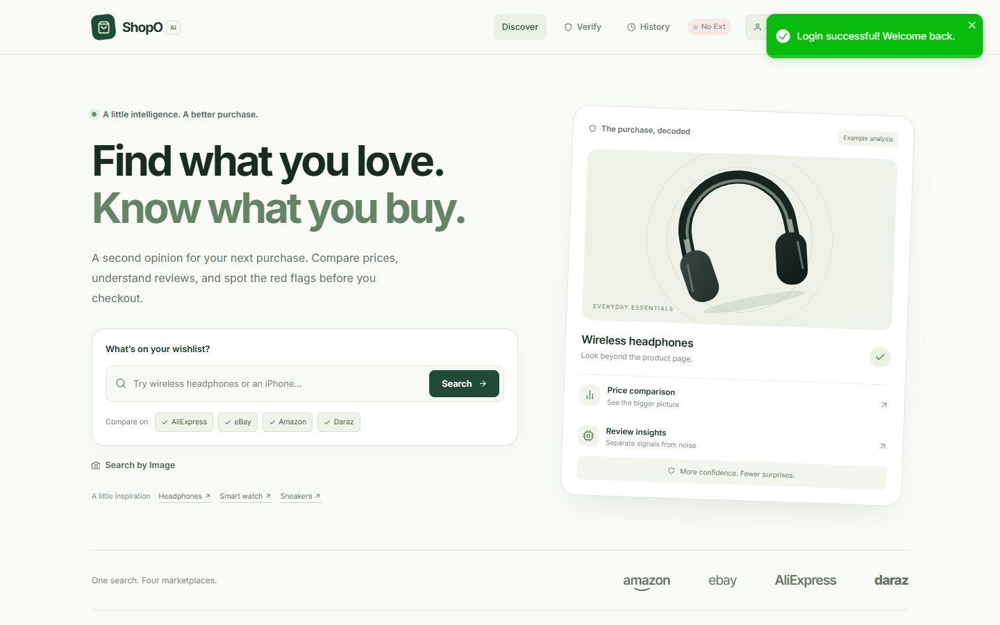
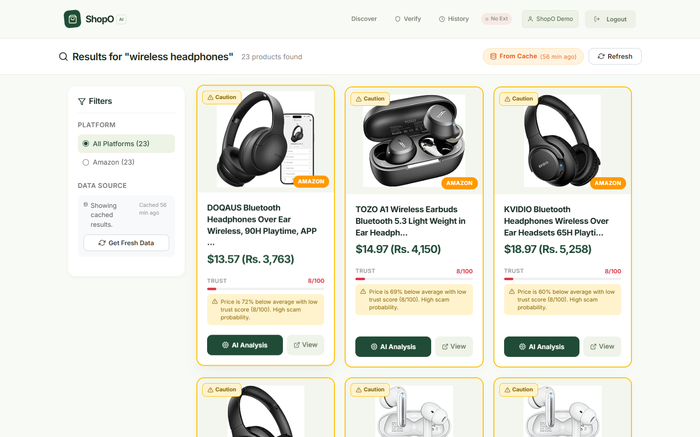
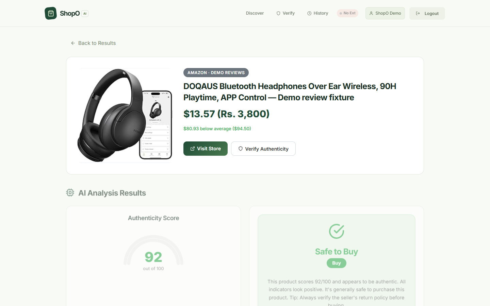
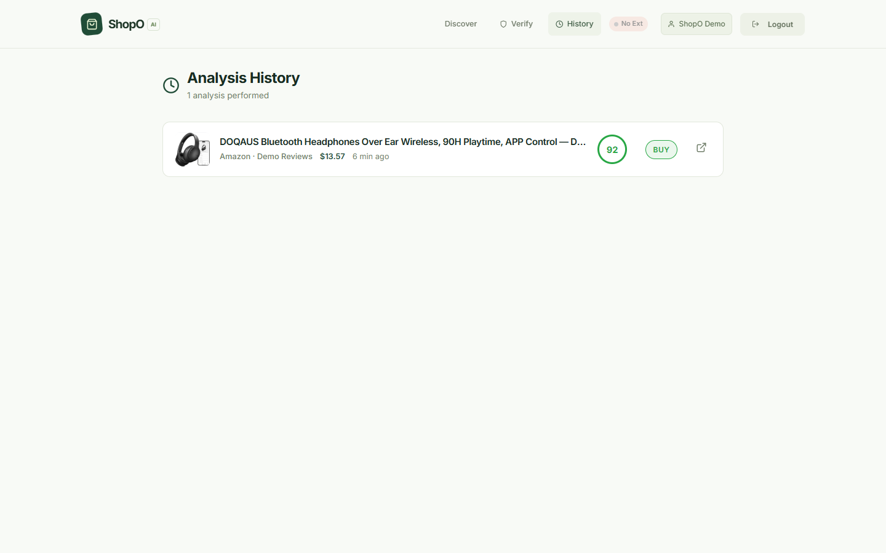
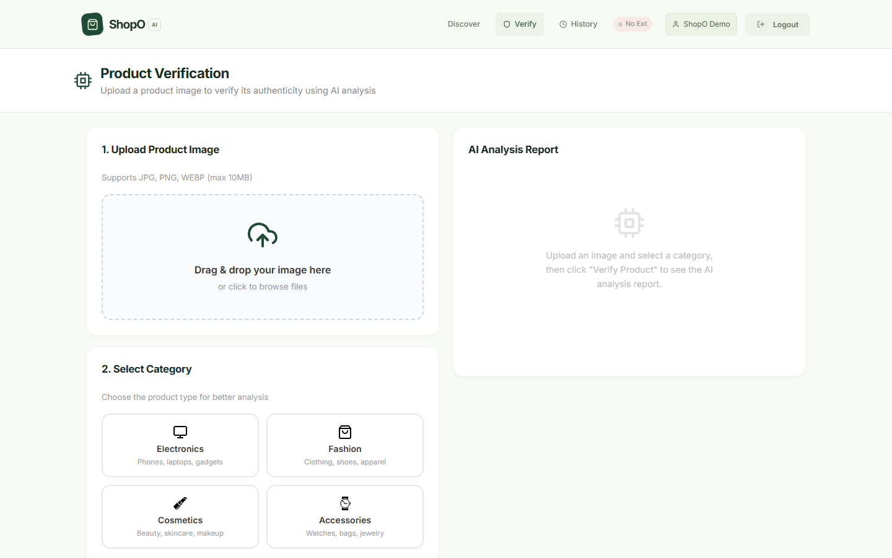
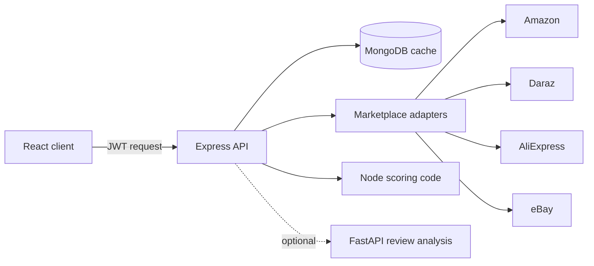

# ShopO-AI

**ShopO-AI helps shoppers compare marketplace prices and understand the signals behind a buying decision.** Search Amazon, Daraz, AliExpress, and eBay, receive results as they arrive, explore review sentiment and seller signals, and revisit saved analyses. Optional image analysis adds visual observations to the research process.

Built with React, Express, MongoDB, and an optional Python analysis service, ShopO-AI emphasizes explainable shopping guidance. Scores are heuristic estimates, not authenticity certifications.

**Release status: hardened prototype; commercial launch remains gated.** See the [market-readiness audit](docs/MARKET_READINESS.md) for verified changes, bottlenecks, and release criteria. This project originated as a Final Year Project at FAST-NUCES Peshawar.

The project was developed by **Syed Ahmad Mujtaba Shah** and **Muhammad Waseel** under the supervision of **Dr. Usman Wajid**.



## What the project does

- Searches Amazon, Daraz, AliExpress, and eBay through separate marketplace adapters.
- Streams results to the React client as each marketplace finishes.
- Stores searches and completed analyses in MongoDB.
- Compares listing prices and shows platform, seller, rating, and review information when available.
- Calculates a score from price, seller rating, review count, and review sentiment.
- Uses TF-IDF cosine similarity to find repeated reviews and reviews with weak product relevance.
- Can call a Python service for VADER and TextBlob sentiment analysis and additional review checks.
- Keeps an analysis history for each signed-in user.
- Includes an experimental Chrome extension for collecting listing data.

The score is a rule-based risk estimate. It has not been validated as a counterfeit detector, so it should not be treated as proof that a product is genuine or fake.

## Screenshots

### Marketplace results

The screenshot below contains cached results from a live Amazon search performed during the project audit.



### Product analysis

The product and image came from the same Amazon search. The review text used to demonstrate the analysis screen is marked as demo data in the interface.



### Analysis history



### Image verification screen



Image verification needs an OpenRouter API key. It was not run during the audit because no key was configured.

## Project structure

```text
client/             React frontend
server/             Express API, MongoDB models, scrapers, and scoring code
python-ai/          Optional FastAPI review-analysis service
extension/          Chrome extension prototype
logo-detection/     Logo dataset folders and research notebook
docs/               Technical notes, screenshots, and portfolio text
start-local.ps1     Windows development launcher
```

## How a search works



1. The user signs in and chooses the marketplaces to search.
2. The API checks MongoDB for a recent result.
3. If there is no cached result, the selected adapters run and return their results separately.
4. The client receives progress and products over Server-Sent Events.
5. When the user opens an analysis, the API calculates the score and saves it to MongoDB.

More detail is available in [docs/ARCHITECTURE.md](docs/ARCHITECTURE.md).

## Technology used

| Part | Tools |
|---|---|
| Frontend | React, React Router, Recharts |
| Backend | Node.js, Express, Mongoose |
| Database | MongoDB |
| Authentication | JWT, bcrypt |
| Scraping | Puppeteer, Cheerio, Axios |
| Text analysis | AFINN, Natural, VADER, TextBlob, scikit-learn |
| Python API | FastAPI, Uvicorn |
| Checks | Node test runner, unittest, Jest, GitHub Actions |

## Local setup

Requirements:

- Node.js 20 or newer
- Python 3.10 or newer
- MongoDB running on port 27017
- Chrome or Chromium for marketplace scraping

```bash
git clone https://github.com/mujtabashah1/ShopO-AI.git
cd ShopO-AI
npm run install-all
python -m venv python-ai/.venv
```

Activate the Python environment:

```powershell
# Windows
.\python-ai\.venv\Scripts\Activate.ps1
```

```bash
# macOS or Linux
source python-ai/.venv/bin/activate
```

Then install the Python packages and create the local environment file:

```bash
pip install -r python-ai/requirements.txt
cp .env.example .env
cp client/.env.example client/.env
# Replace JWT_SECRET with a generated secret before starting.
npm run dev-all
```

The frontend runs at `http://localhost:3000`, the Express API at `http://localhost:5000`, and FastAPI at `http://localhost:8000`.

Windows users can also run:

```powershell
powershell -ExecutionPolicy Bypass -File .\start-local.ps1
```

## Environment variables

| Name | Use |
|---|---|
| `MONGO_URI` | MongoDB connection string |
| `JWT_SECRET` | Secret used to sign login tokens |
| `PORT` | Express port |
| `PYTHON_AI_URL` | FastAPI service URL |
| `PYTHON_AI_ENABLED` | Enables or disables the Python service call |
| `OPENROUTER_API_KEY` | Required only for image identification and verification |
| `OPENROUTER_MODEL` | Vision model used through OpenRouter |
| `CLIENT_URL` | Allowed frontend origin |

Copy `.env.example` and replace its placeholders. Generate a secret with `node -e "console.log(require('crypto').randomBytes(32).toString('hex'))"`. Startup rejects missing, short, or placeholder JWT secrets. Do not commit `.env`.

Set `REACT_APP_API_URL` in `client/.env` before building a deployed frontend, including the `/api` suffix. `CLIENT_URL` accepts comma-separated **exact** browser origins; preview deployments require explicit entries. Set the same `PYTHON_AI_KEY` in both services when Python analysis is enabled in production. See [deployment notes](docs/DEPLOYMENT.md).

## Database access

The default local URI is:

```text
mongodb://localhost:27017/smartshop
```

Open that URI in MongoDB Compass, or use `mongosh`:

```javascript
mongosh "mongodb://localhost:27017/smartshop"
show collections
db.users.find({}, { password: 0 })
db.searches.find().limit(5)
db.analyses.find().sort({ createdAt: -1 }).limit(5)
```

Create users through the registration screen or `/api/auth/register` so passwords are hashed correctly.

## Main API routes

| Method | Route | Use |
|---|---|---|
| POST | `/api/auth/register` | Register a user |
| POST | `/api/auth/login` | Sign in |
| GET | `/api/auth/me` | Get the current user |
| GET | `/api/products/search` | Search marketplaces |
| GET | `/api/products/search/stream` | Stream search progress and results |
| POST | `/api/analysis/analyze` | Run and save an analysis |
| GET | `/api/analysis/history` | Read the current user’s history |
| GET | `/api/analysis/:id` | Read one saved analysis |
| POST | `/api/analysis/verify-image` | Verify an uploaded image through the configured provider |

See [docs/API_REFERENCE.md](docs/API_REFERENCE.md) for the remaining routes.

## Tests

```bash
npm test
cd client
npm test -- --watchAll=false --runInBand
npm run build
```

Current deterministic coverage includes 16 Node checks, six Python checks, and five frontend checks. Search regression tests use mocked marketplace adapters; they do not certify live marketplace availability. Earlier live counts and screenshots are historical examples.

CI runs backend and Python tests, frontend tests, and a production frontend build. Dependency audits and live deployment checks are separate release gates.

## Current limitations

- eBay selectors need to be updated.
- Marketplace page changes or access controls can break a scraper.
- Currency conversion fetches live rates but falls back to static estimates when providers fail.
- Sentiment analysis works best on straightforward English reviews.
- Image verification depends on an external provider.
- The local logo matcher and ONNX file are not connected to the active API.
- The logo dataset does not include clear provenance or redistribution terms.
- There is no project-level licence file.

The full audit is recorded in [docs/TESTING.md](docs/TESTING.md) and [docs/KNOWN_LIMITATIONS.md](docs/KNOWN_LIMITATIONS.md).
