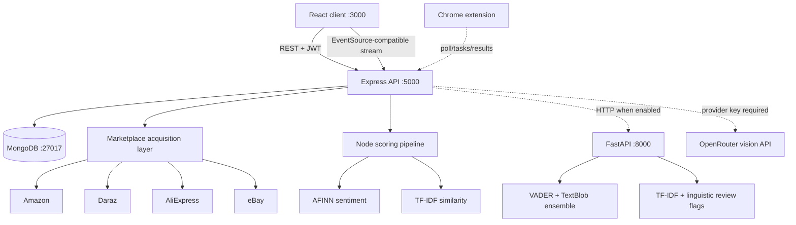

# Architecture

## Runtime topology

## Main request flow

The React client authenticates through `/api/auth/*` and sends the JWT on protected requests. A search first checks the `Search` collection by user, normalized query, and platform set. Missing data starts the selected Puppeteer/Cheerio adapters. The streaming route emits platform-level progress and results; successful results are cached with a one-hour TTL.

An analysis request passes listing fields and reviews into the Node pipeline. AFINN sentiment, four scoring factors, TF-IDF duplicate detection, and relevance signals form the baseline response. When `PYTHON_AI_ENABLED` is true and FastAPI responds, the controller stores its additional sentiment, fake-review, summarization, and trustworthiness evidence. The final `Analysis` document remains scoped to the authenticated user.

## Score calculation

`authenticityScorer.js` assigns at most 25 points each to price position, seller rating, review count, and positive review sentiment. `verdictEngine.js` subtracts up to five points when more than 30% of supplied reviews participate in high-similarity pairs. Scores map to Buy (75–100), Risky (45–74), or Avoid (0–44).

The name “authenticity score” is retained for UI compatibility. Its actual meaning is a transparent marketplace risk score. No trained product-authenticity model contributes to this active path.

## Service boundaries

- **React:** routing, forms, search orchestration, comparison cards, charts, history, and errors.
- **Express:** authentication, input validation, rate limiting, data acquisition, scoring orchestration, and persistence.
- **MongoDB:** `User`, `Search`, and `Analysis` collections. Passwords are bcrypt hashes; raw passwords are not stored.
- **FastAPI:** optional enhanced text analysis. It is stateless and receives product/review fields from Express.
- **Vision provider:** optional OpenRouter call for image tasks. The provider receives the uploaded image or image URL when enabled.
- **Extension:** optional acquisition worker. It polls protected task endpoints and returns extracted public listing data.

## Failure handling

Marketplace failures are isolated by platform so another adapter can still return results. The Python call degrades to the Node analysis when unavailable. Missing vision credentials produce a service-unavailable response. Controllers use validation and explicit HTTP errors; client pages surface failed platform states and toast notifications.

## Security boundary

JWT middleware protects user data and acquisition routes; auth endpoints validate input, and login is rate limited. Search routes apply rate limiting. CORS is configured from the client-origin setting. Uploaded images use Multer limits and are sent to an external provider only for an explicit verification request. See [Development](DEVELOPMENT.md#security-and-privacy).
